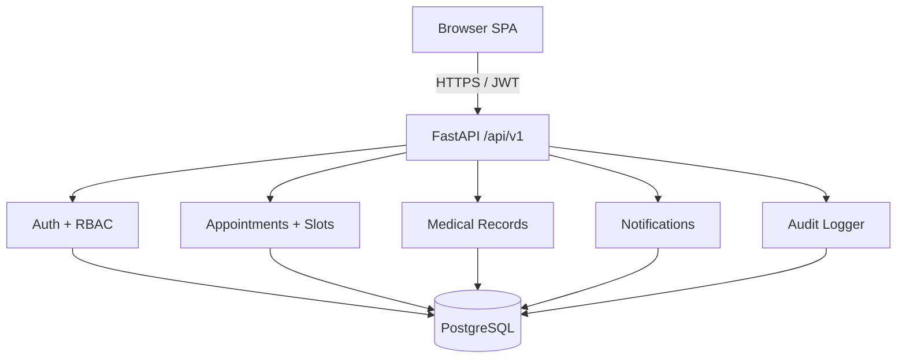
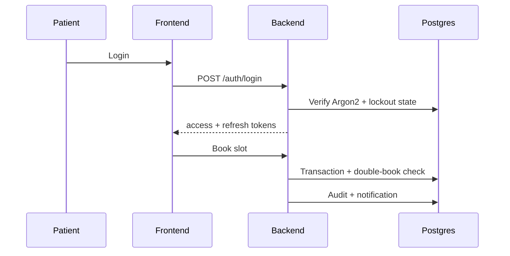
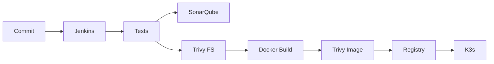

# Architecture

## Data flow

## DevSecOps pipeline

## Module boundaries

Auth, Patients, Doctors, Appointments, Medical Records, Notifications, Audit, Admin — each exposed via versioned REST routers with shared deps for DB/authz.
