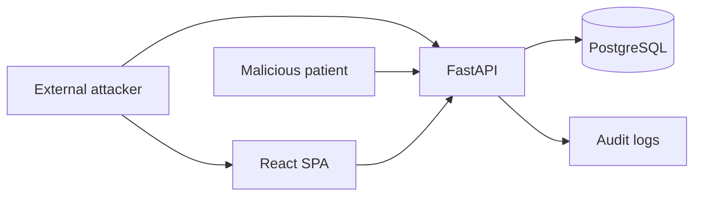

# Threat model (academic)

## Assets

- Synthetic account credentials
- Appointment metadata
- Fictional medical records
- Audit trail integrity

## Key threats & mitigations

| Threat | Mitigation |
| --- | --- |
| Credential stuffing | Rate limit + lockout |
| Token theft | Short access TTL + refresh rotation/revocation |
| IDOR | Object-level authz checks |
| SQLi | SQLAlchemy bound parameters + validation |
| Privilege escalation | Backend RBAC on every route |
| Secret leakage | Env/K8s secrets; never log tokens/passwords |
| Lateral movement in cluster | NetworkPolicy + non-root pods |

## Out of scope

Real PHI, e-prescribing, clinical decision support, production threat hunting.
